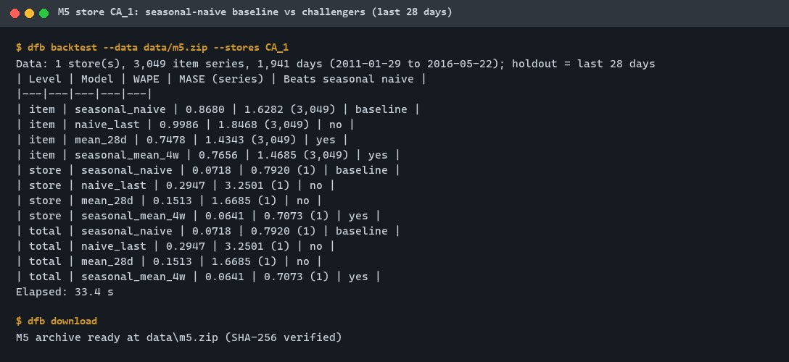
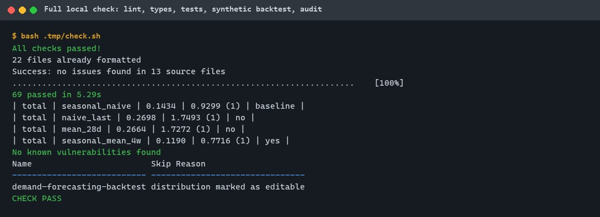
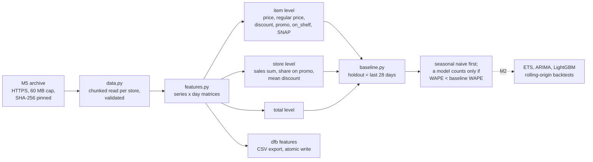
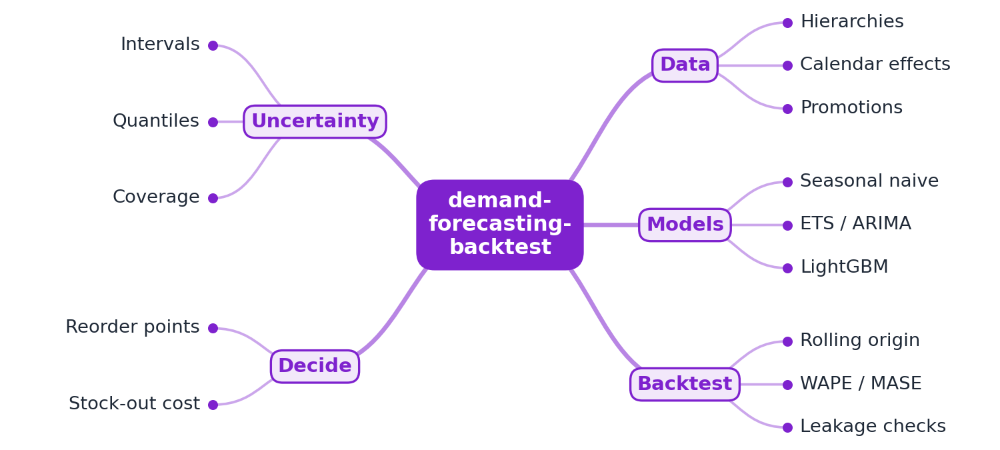

# demand-forecasting-backtest

[](https://github.com/EquinoxWN/demand-forecasting-backtest/actions/workflows/ci.yml)


> Stores run out of best-sellers and overstock the rest: demand forecasts with honest backtesting and uncertainty ranges, not one optimistic number. M1 prepares the M5 Walmart data with leak-free calendar, price and promotion features at item, store and total level, and scores a seasonal-naive baseline that every model has to beat.

Part of my **AI and Machine Learning** list · Python · core project

## Proof it works

On M5 store CA_1 (3,049 item series, 1,941 days), the last 28 days are held out. The seasonal-naive
baseline is scored first at every level, and a challenger counts only with a strictly lower WAPE:
at store level the 4-week weekday mean beats it (WAPE 0.064 vs 0.072) while the last-value and
28-day-mean forecasts do not. At item level both averaging methods beat it (0.748 and 0.766 vs 0.868):



69 tests pass (input validation, verified download with bounded retries, no-look-ahead features,
hierarchy sums, metrics on worked examples, the strict gate), and the dependency audit is clean:



## Architecture

**What M1 runs today:**



**Full roadmap (M1 to M3):**



## How it works

_Steps 1 and 2 are built and tested; the rest is on the [roadmap](#roadmap)._

1. M5 Walmart sales data is prepared with calendar, price and promotion features at item, store and total levels.
2. A seasonal-naive baseline comes first; every model has to beat it to count.
3. Statistical models (ETS, ARIMA) and a global LightGBM model are trained per hierarchy level.
4. Rolling-origin backtests simulate forecasting week by week, never peeking at the future.
5. Prediction intervals are checked for coverage: does an 80% range contain the truth 80% of the time?
6. Forecasts feed a simple reorder-point calculation, turning accuracy into stock-out and overstock cost.

Details of M1:

- **Promotions:** M5 has no promotion flag, so a promotion is a price at least 5% under the
  item's highest price in that store so far ([ADR 0002](docs/adr/0002-promotions-from-price-history.md)).
- **No look-ahead:** every feature on day t uses only prices up to t's Walmart week and no later
  sales; a test changes the future and checks that no earlier value moves.
- **Levels:** item (item x store), store (sum of its items) and total (sum of the selected stores).
- **Baseline and gate:** seasonal naive repeats the last week. Challengers in M1 are simple
  (last value, 28-day mean, 4-week mean per weekday); they show the gate working, they are not
  the M2 models.

## Who it helps

- **Who:** analysts and data scientists who forecast retail demand, and engineers preparing the M5 data.
- **The problem:** forecasts are often judged on data they have partly seen and never compared with the simplest forecast, so nobody can tell whether a model is worth running.
- **How to use it:** `dfb features` exports a validated, leak-free feature table per level; `dfb backtest` scores any forecaster against the seasonal-naive baseline per level and marks whether it counts.

## Tech stack

| Area | In M1 | Planned |
|---|---|---|
| Core | Python 3.11+, NumPy, pandas | statsforecast (ETS, ARIMA), LightGBM |
| Data | M5 (public mirror, SHA-256 checked), synthetic M5-format data for tests | all ten stores |
| Eval | holdout of the last 28 days, WAPE (gate) and MASE, seasonal-naive baseline | rolling-origin backtests, interval coverage, reorder-point cost |

Language: **Python** (3.11+). Code in [`src/demand_forecasting_backtest/`](src/demand_forecasting_backtest): `data.py` (verified download, validated loading), `features.py` (panels and features), `baseline.py` (forecasters, metrics, gate), `synthetic.py` (M5-format test data), `files.py` (atomic writes), `cli.py`.

## Run it

**Prerequisites:** Python 3.11+ (CI uses 3.12). CPU only. About 50 MB of disk for the M5 archive.

```bash
python -m venv .venv && source .venv/bin/activate   # Windows: .venv\Scripts\activate
make setup      # install the package and dev tools
make lint       # ruff, ruff format, mypy --strict
make test       # 69 tests on synthetic data, no download
make run        # download M5 into data/ (SHA-256 checked), score store CA_1
make features   # item-level feature table of CA_1 (5.9 M rows, about 4 minutes)
```

`dfb backtest --synthetic` runs on generated M5-format data in a few seconds. Other stores:
`dfb backtest --stores TX_1`. The loader also reads a directory with the original Kaggle CSV files
(`--data path/to/dir`). No environment variables are read. Downloaded data stays in `data/` and is
never committed.

## Tests and results

Full numbers and the analysis: [docs/results/m1.md](docs/results/m1.md). Quality check (10 rules,
12 hand mutations): [docs/quality/2026-11-01.md](docs/quality/2026-11-01.md).

| Test file | Tests | What it proves |
|---|---|---|
| `test_data.py` | 29 | Store filtering; zip and directory give the same data; calendar with or without `d`; 16 kinds of malformed files refused; unknown stores, missing files and bad archives are `DataError`; download kept only with the right SHA-256, HTTPS only, size cap exact, retries bounded with backoff, no partial file |
| `test_features.py` | 10 | Price, regular price, discount, promo and price change on a worked example; a 3% dip is not a promotion; no look-ahead under perturbed futures; levels add up exactly; promotion share counts only on-shelf items; planted promotion lift visible; export matches the matrices |
| `test_baseline.py` | 18 | Seasonal naive keeps weekday alignment; challengers, WAPE and MASE on worked examples; bad inputs refused; the gate is strict; forecasters never see the holdout; seasonal naive beats last value on planted weekly data |
| `test_cli.py` | 11 | Synthetic backtest table and UTC JSON; feature export complete and byte-identical on re-run; bad arguments and data exit 2; download uses the pinned archive; a failed write keeps the old file |
| `test_smoke.py` | 1 | Package version |

| Check | Result |
|---|---|
| Tests | **69 passed**, 0 failed |
| M5 CA_1, store level WAPE | seasonal naive **0.0718**; 4-week weekday mean 0.0641 (counts); 28-day mean 0.1513 and last value 0.2947 (do not count) |
| M5 CA_1, item level WAPE | seasonal naive **0.8680**; 28-day mean 0.7478 and 4-week weekday mean 0.7656 (count); last value 0.9986 |
| Runtime, CA_1 load + features + scoring | 20.6 s and 33.4 s in two runs (laptop CPU, other jobs running) |
| Feature export, CA_1 item level | 5,918,109 rows, 29 MB gzip, 3 min 47 s |
| Lint / audit | ruff, ruff format, mypy `--strict` clean; `pip-audit`: no known vulnerabilities |

With one store selected the total level equals the store level; multi-store totals are covered by
the tests on synthetic data, not measured on M5 yet.

## Roadmap

**M1** (≈15 h)
- [x] Write `docs/rfc/0001-design.md`: problem, goals, non-goals, chosen design
- [x] M5 Walmart sales data is prepared with calendar, price and promotion features at item, store and total levels.
- [x] A seasonal-naive baseline comes first; every model has to beat it to count.

**M2** (≈20 h)
- [ ] Statistical models (ETS, ARIMA) and a global LightGBM model are trained per hierarchy level.
- [ ] Rolling-origin backtests simulate forecasting week by week, never peeking at the future.

**M3** (≈25 h)
- [ ] Prediction intervals are checked for coverage: does an 80% range contain the truth 80% of the time?
- [ ] Forecasts feed a simple reorder-point calculation, turning accuracy into stock-out and overstock cost.
- [ ] Publish the proof below with real numbers

## Proof

What this repo must show before it counts as done:

- Backtest WAPE vs the naive baseline per level, interval coverage, and simulated inventory cost.

| Result | Value |
|---|---|
| M3 proof above | Not measured yet (M3). Current M1 numbers: see [Tests and results](#tests-and-results). |

## Why it matters

- **Interview angle:** 'Forecast demand for a retailer' and time-series validation questions.
- **Upstream I'd like to contribute to:** Nixtla statsforecast or Darts: docs or examples.

## Design docs

- [RFC 0001: design](docs/rfc/0001-design.md)
- [ADR 0001: record architecture decisions](docs/adr/0001-record-architecture-decisions.md)
- [ADR 0002: infer promotions from each item's price history](docs/adr/0002-promotions-from-price-history.md)
- [ADR 0003: matrices and a strict WAPE gate](docs/adr/0003-matrices-and-a-strict-wape-gate.md)
- [M1 results](docs/results/m1.md)
- [Quality check 2026-11-01](docs/quality/2026-11-01.md)

## Scope

This is a learning and portfolio system, not a hosted production service. Everything runs locally.

## Security and contributing

- Every GitHub Action is pinned to a commit SHA; workflows run read-only, without persisted credentials.
- Dependabot update pull requests are paused (`open-pull-requests-limit: 0`) so the repository keeps a single `main` branch; dependencies are updated by hand and checked by the CI audit.
- The dataset is downloaded only over HTTPS, capped at 60 MB and refused unless its SHA-256 matches the pinned value; all input files are validated before use; CI runs `pip-audit` on every push.
- Report vulnerabilities privately: see [SECURITY.md](SECURITY.md). To contribute, see [CONTRIBUTING.md](CONTRIBUTING.md).

## License

MIT, see [LICENSE](LICENSE).
